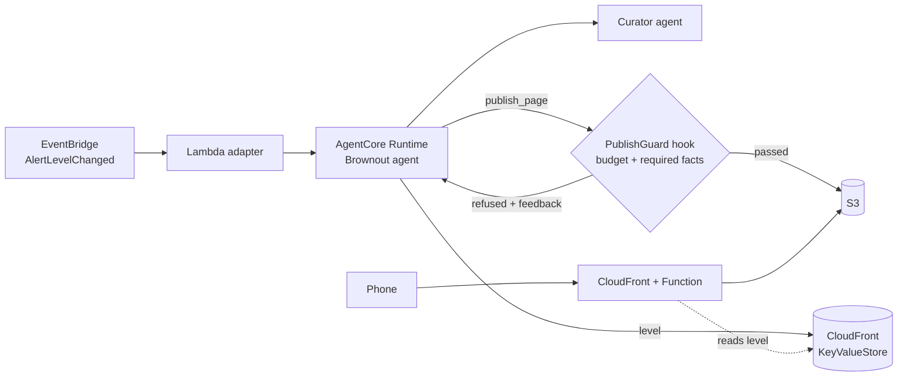

# Brownout

**When disaster strikes, a city website should get lighter, not go down.**

Brownout is an AI agent built with the [Strands Agents SDK](https://strandsagents.com/) that rewrites a heavy city website into a tiny emergency page as the alert level rises, and switches the live site at the edge in seconds.

The name comes from operations: a *brownout* keeps a system alive by turning features off instead of failing completely.

> Example City is fictional. Every name, address and phone number in this repository is made up.

## Live demo

- Example City (follows the current alert level): https://d3u5pnxb6mo4pr.cloudfront.net/
  Between alerts this is the full site, about 28 MB.
- Brownout pages written for a flood: [Level 3](https://d3u5pnxb6mo4pr.cloudfront.net/level-3/index.html), [Level 4](https://d3u5pnxb6mo4pr.cloudfront.net/level-4/index.html), [Level 5](https://d3u5pnxb6mo4pr.cloudfront.net/level-5/index.html)

Alerts are simulated; only the project owner can send them.

## The problem

City websites are built for good days: video backgrounds, photo carousels, maps, web fonts. During a flood or an earthquake, the same site is what people need most, at the moment when mobile networks are congested and phones are on low battery. The people hit hardest are those with the weakest connections: older residents, people on prepaid low-data plans, and anyone in a damaged area.

Example City's normal homepage pulls in **about 28 MB**. On a congested 3G or a 2G connection it does not finish loading within three minutes, and the shelter list sits at the bottom, under the video.

Stripping the media is not enough. A mechanically stripped page is light, but it still says "No alerts at the moment", lists a riverside hall as a shelter during a flood, and mixes festival news with evacuation orders.

## What Brownout does

Brownout follows Japan's five-level evacuation alert system. At each level it publishes a smaller page:

| Alert level | Page | Budget (gzip) |
|---|---|---|
| 1-2 | full site | none |
| 3 - elderly and others evacuate | light | 500 KB |
| 4 - evacuate | lite | 50 KB |
| 5 - emergency safety | survival | 14 KB (fits in the first network round trip) |

1. An `AlertLevelChanged` event reaches Amazon EventBridge.
2. A thin AWS Lambda adapter invokes the Brownout agent on **Amazon Bedrock AgentCore Runtime**.
3. The **Curator** agent (a specialist called as a tool) decides which facts matter for this hazard and level, for example which shelters are safe in a flood.
4. The **Writer** agent writes one self-contained HTML page from the official city data only, and calls `publish_page`.
5. **PublishGuard**, a Strands hook, blocks `publish_page` unless the page fits the byte budget, contains every required fact, and contains no unsafe shelter. The model cannot talk its way past it. Refusals go back to the agent as concrete feedback.
6. Only a page that passed is written to Amazon S3, and only then is the alert level written to **CloudFront KeyValueStore**.
7. A **CloudFront Function** reads that value on every request and routes all URLs to the page for the current level. No deployment and no cache invalidation are needed to switch.



## Results

### Is the page right? (`scripts/evaluate.py`)

Six scenarios (flood and earthquake, levels 3 to 5). Each agent variant ran 3 times per scenario. A page passes only if it fits the budget, keeps every required fact and shows no unsafe shelter.

| Variant | Pass rate | Required facts kept | Pages with an unsafe shelter | Avg size (gzip) |
|---|---|---|---|---|
| Mechanical stripping | 0% | 75% | 3 of 6 | 1,270 B |
| Agent without PublishGuard | 72% (2 of 18 runs published nothing) | 97% | 2 of 16 | 877 B |
| **Brownout** (agent + PublishGuard) | **100%** | **100%** | **0 of 18** | **844 B** |

Model: Amazon Nova 2 Lite on Amazon Bedrock. Raw results: `results/eval-nova2lite-3trials.json`.

### Is the page fast? (`scripts/loadtest.py`)

Chrome with DevTools network emulation, cache disabled.

| Network | Full site, fully loaded | Brownout pages, fully loaded |
|---|---|---|
| Congested 3G (400 kbit/s, 400 ms RTT) | did not finish in 180 s | 0.5 s |
| 2G (50 kbit/s, 500 ms RTT) | did not finish in 180 s | 1.0 s |

Raw results: `results/loadtest.json`.

### How fast does the live site switch? (`scripts/alert.py`)

From sending the event to the live CloudFront URL showing the new page: 24 to 55 seconds over four runs. The agent itself takes about 5.5 s; Lambda including a new AgentCore Runtime session 11 to 13 s; the rest is KeyValueStore propagation to the edge. Raw results: `results/switch-times.json`.

## Repository layout

| Path | What it is |
|---|---|
| `content/town.json` | The only source of facts (fictional city data) |
| `content/must_have.json` | Required and forbidden facts per hazard and level, plus byte budgets |
| `brownout/agent.py` | Curator + Writer agents and the PublishGuard hook |
| `brownout/facts.py` | Shared checks (budget, required facts) |
| `brownout/baseline.py` | Mechanical stripping, for comparison |
| `brownout/edge.py` | Publish to S3, flip the level in CloudFront KeyValueStore |
| `runtime/main.py` | AgentCore Runtime entrypoint |
| `infra/` | CloudFront Function router, edge and trigger setup scripts |
| `scripts/` | Site generator, measurement, evaluation, load test, alert simulator |

## Run it

Requirements: Python 3.13 with [uv](https://docs.astral.sh/uv/), Node.js (for the AgentCore CLI), ffmpeg, an AWS account with Amazon Bedrock access to Amazon Nova in us-east-1.

```bash
uv sync
uv run python scripts/build_full_site.py           # generate the heavy site (about 28 MB)
uv run python scripts/measure.py site/full/index.html
PYTHONPATH=. uv run python scripts/evaluate.py --trials 3

# AWS
uv run python infra/deploy_infra.py                 # S3, CloudFront, KeyValueStore, Function
PYTHONPATH=. uv run python -c "from pathlib import Path; from brownout.edge import upload_dir, set_level; upload_dir(Path('site/full'), 'full'); set_level(1)"
scripts/deploy_runtime.sh                           # AgentCore Runtime (agentcore CLI)
uv run python infra/deploy_trigger.py <runtime-arn> # EventBridge -> Lambda -> Runtime
PYTHONPATH=. uv run python scripts/alert.py flood 4 # raise the alert and time the switch
```

The AgentCore project in `deploy/brownoutrt` was created with `agentcore create --template empty` and `agentcore add runtime --name Brownout --language python`, passing the bucket and KeyValueStore ARN as environment variables and `infra/runtime-policy.json` as an additional policy.

## Credits and license

- Code: Apache License 2.0 (see `LICENSE`). Copyright ikenyal.
- Font in the generated full site: Noto Sans JP, SIL Open Font License 1.1.
- All images, the map and the video are generated by `scripts/build_full_site.py`.
